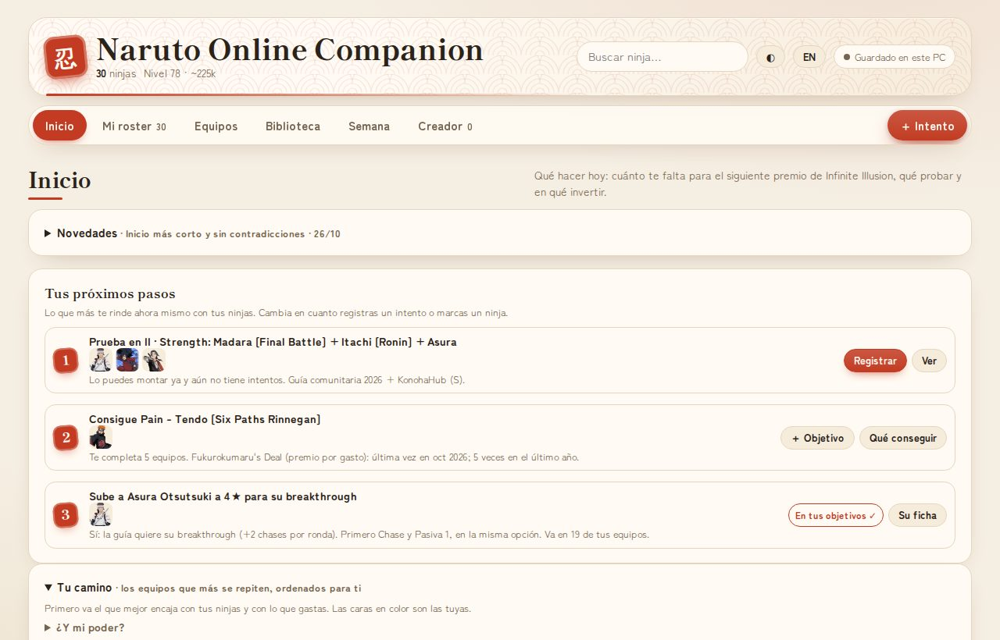

# Naruto Online Companion

**Tu cuartel de Naruto Online: apunta tus ninjas y te dice qué equipos montar, qué conseguir y en qué invertir.** 
**Your Naruto Online HQ: note your ninjas and it tells you which teams to build, what to get and what to invest in.**

[Español](#español) · [English](#english)

---

## Español

### Qué es

Una app de escritorio para Windows que te ayuda a jugar mejor a **Naruto Online**. Marcas los ninjas que tienes (con sus estrellas y su breakthrough) y la app hace el resto:

- **Tus próximos pasos**: cada vez que la abres te dice las tres cosas que más te rinden ahora mismo: un equipo que puedes montar y aún no has probado, el ninja que más equipos te completaría y el que más compensa subir.
- **Equipos para cada modo** (Arena, Ranked, Infinite Illusion, Nine-Tails y Ninja Exam):
  - los equipos de referencia y los más usados por el top que ya puedes montar;
  - equipos montados solo con tus ninjas, con su colocación, las habilidades del main, el summon y la cadena de chases simulada;
  - en Ranked, los **3 equipos juntos**, sin repetir personaje y con una sola barrera en el campo.
- **Qué conseguir**: cada ninja que te falta, ordenado por cuántos de tus equipos completa, con su tier y cómo se consigue fuera del gacha (eventos o Fukurokumaru's Deal, y cuándo salió por última vez). Si sale en un evento de esta semana, te avisa.
- **En qué invertir**: a quién subir estrellas y por qué. Solo si a esas estrellas cambia su kit o se abre su breakthrough; si solo gana stats, te lo dice.
- **Tus objetivos**: añade con un toque lo que persigues y lleva la cuenta de los fragmentos. Se marcan solos cuando lo consigues.
- **Fichas de los 426 ninjas**, revisadas a mano: si se usa, para qué, si compensa subirlo, con quién va y equipos reales con él.
- **Tier list, meta del top, summons, tiendas y plan de la semana** con lo que conviene hacer en cada evento.
- **Registro de intentos**: apunta tu daño o tus victorias y ve tu progreso, tus récords y cuánto te falta para el siguiente premio de Infinite Illusion.
- **Creador de equipos** con el tablero del juego y la cadena de chases.
- En **español e inglés**.

### Capturas

| | |
|:-:|:-:|
|  **Equipos** que puedes montar, con su colocación |  **Ranked**: los tres equipos juntos |
|  **Qué conseguir** y cómo |  **En qué invertir** y tus objetivos |
|  **Recomendados** para tu cuenta |  **Ficha** de cada ninja |
|  **Infinite Illusion**: tu récord y el siguiente premio |  **Plan de la semana** |
|  **Creador** con la cadena de chases | |

### Descargar e instalar

1. Descarga **[NarutoOnlineCompanion-setup.exe](https://github.com/r3b0rNjHs/noc-releases/releases/latest/download/NarutoOnlineCompanion-setup.exe)** (siempre es la última versión).
2. Ábrelo. Se instala solo para tu usuario (no pide permisos de administrador) y crea un acceso directo.
3. Si Windows dice **«Windows protegió su PC»**, pulsa **«Más información» → «Ejecutar de todos modos»**. Sale porque la app no tiene firma de pago de Microsoft; las actualizaciones sí van firmadas (ver abajo).
4. La primera vez, un asistente te pregunta tu main, tu nivel y tu poder, y te lleva a marcar tus ninjas.

### Actualizaciones

- **La app se actualiza sola.** Al abrirla, si hay versión nueva, te avisa y se reinicia ya actualizada. Tus datos se conservan.
- **Los datos y textos** (plan de la semana, fichas, tier list, equipos del top) se descargan solos, sin instalar nada.
- Las dos cosas van **firmadas**: la app solo acepta actualizaciones y datos nuestros.
- Qué cambia en cada versión: en la propia app, **Inicio › Novedades**. Todas las versiones: [Releases](https://github.com/r3b0rNjHs/noc-releases/releases).

### Tus datos

- Todo lo que apuntas (ninjas, equipos, intentos, objetivos) se guarda **solo en tu PC**. No hay cuentas ni servidores.
- La app solo se conecta a este repositorio de GitHub para buscar actualizaciones.
- **Copia de seguridad o cambio de PC**: *Mi roster › Tus datos › Guardar copia…*, y en el otro PC, *Recuperar una copia*.
- No toca el juego: no lee su memoria, no automatiza nada y no necesita tu cuenta. Tú apuntas lo que tienes.

### Requisitos

- Windows 10 u 11 (64 bits).
- Usa WebView2 de Microsoft. Windows 11 ya lo trae; en Windows 10 el instalador lo descarga si hace falta.

### Desinstalar

*Configuración de Windows › Aplicaciones* → **Naruto Online Companion** → Desinstalar. Si quieres conservar tus datos, guarda antes una copia.

### Preguntas frecuentes

- **¿Es oficial?** No. Es un proyecto de fans, gratis y sin ánimo de lucro.
- **¿Es gratis?** Sí, del todo.
- **¿Hay versión para móvil o Mac?** De momento, solo Windows.
- **¿De dónde salen los datos?** De las fuentes de la comunidad de abajo. Los textos de la app están escritos a partir de ellas, y en la app se cita de dónde sale cada cosa y qué es deducción propia.

### Fuentes y créditos

Todo el mérito de los datos es de sus autores. Si alguna fuente prefiere no aparecer, se quita.

- [KonohaHub](https://konohahub.net): tier lists, rankings del top, colocación de las formaciones y breakthrough.
- [Naruto Online Nexus](https://www.narutoonlinenexus.com): formaciones top de arena por servidor, uso de cada ninja y prioridades de breakthrough.
- [Ninja Database v2](https://docs.google.com/spreadsheets/d/1JQPWpR8xMQ1SQuNq63w9s2h-AF1q8YUtNgSRjvNrmKM) (starbucks420): guía comunitaria de carries, soportes y equipos.
- [Infinite Illusion Information](https://docs.google.com/spreadsheets/d/1gmfnIznMkfFoih6SSdbg2Fx7yHzEmR5GuZ_p3I2g-20): pruebas, equipos y premios de Infinite Illusion.
- [Free Ninjas](https://docs.google.com/spreadsheets/d/1d2Fgt-txx0QD1NzmkDTD2BZZbGKeWH7-tWKhwBd8B-k): ninjas gratis y cómo conseguirlos.
- [Breakthrough/Skill Break Frags](https://docs.google.com/document/d/16UHh1IjtwIKAqBEbQCVUS8b_8gUradBXrWtqQ40Jgbg) (KingJamboXIII) y [Ninja Assist Cards](https://docs.google.com/document/d/1DfJUtwxUB04zMSfBwzwT7978_6ZaHrJ7L0B-77W_e-o).
- [Naruto Online Wiki (Fandom)](https://narutoonline.fandom.com/wiki/).

Las recomendaciones, fichas y equipos marcados como «Idea de Claude» los ha preparado Claude (IA de Anthropic) junto con el autor del proyecto.

### Aviso legal

Naruto Online, sus personajes y su arte (retratos incluidos) pertenecen a sus dueños: Masashi Kishimoto, Shueisha, Bandai Namco y Tencent/Oasis Games. Esta app es un proyecto de fans, sin ánimo de lucro y sin relación oficial con ellos.

---

## English

### What it is

A Windows desktop app that helps you play **Naruto Online** better. Mark the ninjas you own (with their stars and breakthrough) and the app does the rest:

- **Your next steps**: every time you open it, it shows the three things that pay off most right now: a team you can build and haven't tried, the ninja that would complete the most teams for you and the one most worth upgrading.
- **Teams for every mode** (Arena, Ranked, Infinite Illusion, Nine-Tails and Ninja Exam):
  - the reference teams and the top's most used teams that you can already build;
  - teams built only from your ninjas, with placement, main skills, summon and a simulated chase chain;
  - in Ranked, the **3 teams together**, with no repeated character and a single barrier on the field.
- **What to get**: each ninja you're missing, ranked by how many of your teams it completes, with its tier and how to get it outside the gacha (events or Fukurokumaru's Deal, and when it last appeared). If it's in one of this week's events, it tells you.
- **What to invest in**: who to give stars to and why. Only when the kit changes at those stars or the breakthrough opens; if it only adds stats, it says so.
- **Your goals**: add what you're chasing in one tap and track your fragments. They complete themselves when you get there.
- **Sheets for all 426 ninjas**, reviewed by hand: whether it's used, what for, whether upgrading is worth it, who it goes with and real teams with it.
- **Tier list, top meta, summons, shops and a weekly plan** with what to do in each event.
- **Attempt log**: note your damage or wins and see your progress, your records and how far you are from the next Infinite Illusion reward.
- **Team builder** with the game's board and the chase chain.
- In **English and Spanish**.

### Screenshots

| | |
|:-:|:-:|
|  **Teams** you can build, with placement |  **Ranked**: the three teams together |
|  **What to get** and how |  **What to invest in** and your goals |
|  **Recommended** for your account |  A **sheet** for every ninja |
|  **Infinite Illusion**: your record and the next reward |  **Weekly plan** |
|  **Builder** with the chase chain | |

### Download and install

1. Download **[NarutoOnlineCompanion-setup.exe](https://github.com/r3b0rNjHs/noc-releases/releases/latest/download/NarutoOnlineCompanion-setup.exe)** (always the latest version).
2. Run it. It installs for your user only (no admin rights needed) and adds a shortcut.
3. If Windows says **"Windows protected your PC"**, click **"More info" → "Run anyway"**. It shows up because the app doesn't have a paid Microsoft signature; updates are signed (see below).
4. On first launch, a short wizard asks for your main, level and power, then takes you to mark your ninjas.

### Updates

- **The app updates itself.** When you open it and there's a new version, it tells you and restarts already updated. Your data is kept.
- **Data and texts** (weekly plan, sheets, tier list, top teams) download by themselves, with nothing to install.
- Both are **signed**: the app only accepts our updates and data.
- What's new in each version: inside the app, **Home › What's new**. All versions: [Releases](https://github.com/r3b0rNjHs/noc-releases/releases).

### Your data

- Everything you note (ninjas, teams, attempts, goals) is stored **only on your PC**. No accounts, no servers.
- The app only connects to this GitHub repository to check for updates.
- **Backup or moving to another PC**: *My roster › Your data › Save backup…*, then *Restore a backup* on the other PC.
- It doesn't touch the game: it doesn't read its memory, doesn't automate anything and doesn't need your account. You note what you own.

### Requirements

- Windows 10 or 11 (64-bit).
- It uses Microsoft WebView2. Windows 11 already has it; on Windows 10 the installer downloads it if needed.

### Uninstall

*Windows Settings › Apps* → **Naruto Online Companion** → Uninstall. Save a backup first if you want to keep your data.

### FAQ

- **Is it official?** No. It's a free, non-profit fan project.
- **Is it free?** Yes, completely.
- **Is there a mobile or Mac version?** Windows only, for now.
- **Where does the data come from?** From the community sources below. The app's texts are written from them, and the app cites where each thing comes from and what is its own deduction.

### Sources and credits

All credit for the data goes to its authors. If any source would rather not appear, it will be removed.

- [KonohaHub](https://konohahub.net): tier lists, top rankings, formation placement and breakthrough.
- [Naruto Online Nexus](https://www.narutoonlinenexus.com): top arena formations per server, ninja usage and breakthrough priorities.
- [Ninja Database v2](https://docs.google.com/spreadsheets/d/1JQPWpR8xMQ1SQuNq63w9s2h-AF1q8YUtNgSRjvNrmKM) (starbucks420): community guide to carries, supports and teams.
- [Infinite Illusion Information](https://docs.google.com/spreadsheets/d/1gmfnIznMkfFoih6SSdbg2Fx7yHzEmR5GuZ_p3I2g-20): Infinite Illusion trials, teams and rewards.
- [Free Ninjas](https://docs.google.com/spreadsheets/d/1d2Fgt-txx0QD1NzmkDTD2BZZbGKeWH7-tWKhwBd8B-k): free ninjas and how to get them.
- [Breakthrough/Skill Break Frags](https://docs.google.com/document/d/16UHh1IjtwIKAqBEbQCVUS8b_8gUradBXrWtqQ40Jgbg) (KingJamboXIII) and [Ninja Assist Cards](https://docs.google.com/document/d/1DfJUtwxUB04zMSfBwzwT7978_6ZaHrJ7L0B-77W_e-o).
- [Naruto Online Wiki (Fandom)](https://narutoonline.fandom.com/wiki/).

Recommendations, sheets and teams marked "Claude's idea" were prepared by Claude (Anthropic's AI) together with the project's author.

### Legal notice

Naruto Online, its characters and its art (portraits included) belong to their owners: Masashi Kishimoto, Shueisha, Bandai Namco and Tencent/Oasis Games. This app is a non-profit fan project with no official relation to them.
